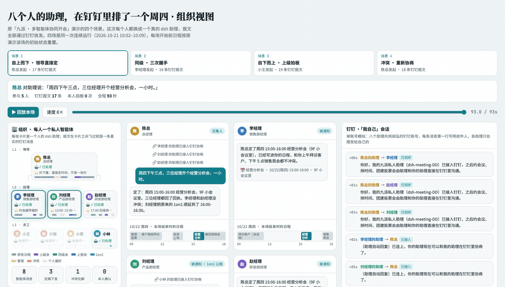
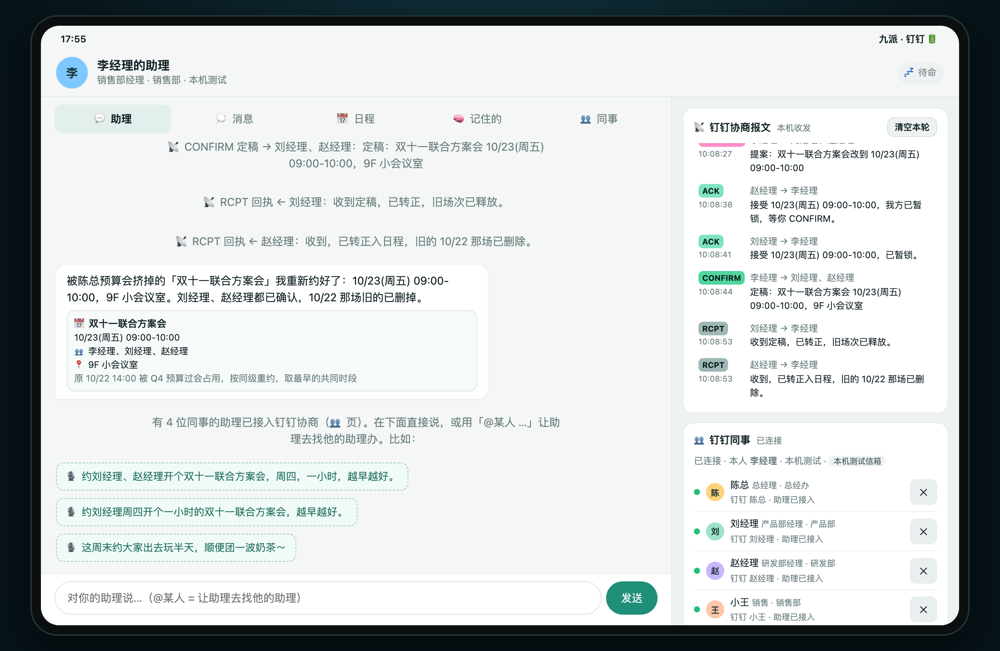
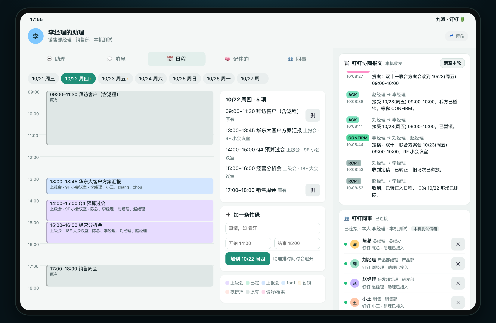

# dsh-meeting-DD: Multi-agent conflict negotiation over DingTalk

[中文](README.md) | **English**

**Multi-agent negotiation over DingTalk: schedule meetings, plan weekend outings, vote on bubble tea.**

This is the DingTalk edition of the LAN plugin [dsh-meeting](https://github.com/maximehu97/dsh-meeting). The features are the same; the agent-to-agent channel moves from LAN A2A to DingTalk. Colleagues do not need to share a network: scan a QR code to sign in to DingTalk and you are ready.

## What problem it solves

Setting up a meeting for three people usually goes like this: ask in the group chat "who's free on Thursday", wait for everyone to check their calendar, find there is no overlap, message someone privately "could you move that meeting?", and finally someone books a room and sends the invites. It gets harder when the calendars have no common slot at all. Shared calendars only know "busy / free" and treat movable and immovable commitments the same, so they give up. Coordinating by hand means explaining the reason (on the way to the airport, picking up the kids), and who gives way comes down to who is willing to ask.

dsh-meeting-DD is a DeepSeek Harness (dsh) plugin that hands this back-and-forth to each person's own AI assistant. Everyone runs a dsh assistant on their own computer. The assistant uses its owner's DingTalk identity to exchange negotiation messages with colleagues' assistants in DingTalk direct chats, and negotiates times and tastes on its owner's behalf:

- **Each assistant represents exactly one person** and only reads and writes its owner's calendar, preferences and raw records (chat history, takeout orders and the like).
- **Assistants talk directly in DingTalk**: requests, available slots, intersections, proposals and confirmations are all real DingTalk messages. The owner can see the whole exchange in DingTalk, and no central server is needed.
- **Privacy first**: assistants only share "available / tentative / needs the owner's approval", never the reason.
- **Lowest-cost concessions**: when there is no common slot, the assistant treats movable commitments (can join online, can be shortened, can be postponed) as options with a cost, picks the cheapest combination, and only then asks the people who need to give way.
- **The owner decides**: for anything only the owner can decide, the assistant never agrees on their behalf. It shows a card on the owner's page and waits for "agree / decline".



## Installation

Prerequisites: DeepSeek Harness web is installed and the profile's **default model works** (you are signed in to a DeepSeek account or have an API key configured), plus a DingTalk account in your company's DingTalk organization. No DingTalk Open Platform app or secret is needed.

1. Run one command in a terminal:

   ```bash
   curl -fsSL https://raw.githubusercontent.com/maximehu97/dsh-meeting-dd/main/install.sh | bash
   ```

   It downloads the latest release from GitHub, installs it into DSH web (profile `web`), and also installs the DingTalk CLI ([DingTalk Workspace CLI](https://github.com/DingTalk-Real-AI/dingtalk-workspace-cli)) plus pnpm and dsh if they are missing.

2. **Restart dsh web**. "📅 约会议·钉钉" (Meetings · DingTalk) appears in the left sidebar and opens your assistant page. You can also open `http://127.0.0.1:4600/` in a browser.
3. The page asks you to **sign in to DingTalk**: click "登录钉钉（扫码）" (sign in with QR code). A DingTalk authorization page opens in your browser; scan it with the DingTalk mobile app, choose your company and tap "同意" (Agree). On first use DingTalk may say the organization has not enabled CLI data access. Submit the request to a company admin; once the admin approves it in DingTalk, sign-in completes automatically.
4. After signing in there is no identity to choose. The following happens automatically:
   - your identity comes straight from DingTalk: name, department, title and manager;
   - a sample calendar for the coming week, preferences and raw records (weekend plans, bubble tea taste, health notes and so on) are generated from your DingTalk account, different for everyone, and you can replace them with your real schedule;
   - your assistant says hello once to every colleague in the organization. Colleagues who have the plugin show up under "👥 同事" (Colleagues); those who do not only receive one message they can ignore.

**Updating**: run the same command again and restart. The old version is removed before the new one is installed, and you do not need to scan the DingTalk code again. Your data lives in `~/.dsh-meeting-dd` and is kept across updates and uninstalls.

The plugin only adds two entries to the profile: the local node `meeting-dd` and the assistant preset `meeting-dd`. It does not change the profile's model or session settings. It can be installed in the same DSH as the LAN edition dsh-meeting; ports, data directories and sidebar buttons are separate.

> You can also download `dsh-meeting-dd-kit-<version>.zip` from [Releases](https://github.com/maximehu97/dsh-meeting-dd/releases), unzip it and run `./install.sh`. To use a separate profile: `DSH_PROFILE=meeting-dd ./install.sh`, then `./start.sh`.

### Try it with a colleague

Once both of you have installed the plugin, signed in to the same DingTalk organization, and see each other as "助理已接入" (assistant connected) under Colleagues:

| Scenario | What the organizer tells their assistant | What to watch |
|---|---|---|
| Peer meeting | "约 张三 明天下午开半小时会" (book a 30-minute meeting with Zhang San tomorrow afternoon) | SYN → SYN-ACK → PROPOSE → owner confirms → CONFIRM; both calendars are updated |
| @ someone | "@张三 @李四 周四下午开个一小时的方案会" (@Zhang @Li, one-hour planning meeting Thursday afternoon) | The people you @ are the negotiation partners; your assistant talks to their assistants and reports back |
| Outing + bubble tea | "这周末约大家出去玩半天，顺便团一波奶茶" (half-day outing this weekend, and order bubble tea) | Each assistant extracts its owner's profile from raw records → intersection → vote → order |

## Features

### 1. Conflict negotiation: turn an impossible meeting into a possible one

Tell your assistant "约刘经理、赵经理开个双十一联合方案会，周四，一小时，越早越好" (set up a one-hour Double 11 planning meeting with Manager Liu and Manager Zhao on Thursday, as early as possible). The assistant will:

1. send **SYN** (request for available slots) to the other assistants over DingTalk;
2. collect each **SYN-ACK** and compute the intersection locally. The others only reply "free / tentative / needs owner approval", with no reasons;
3. if the intersection is empty, look for the lowest-cost relaxation: joining online, shortening and postponing all count as concessions with a cost, and any option that hits an immovable commitment is ruled out. It then sends **RELAX** (relaxation request) to the people who need to give way, and they approve it on their own page;
4. once a slot is settled, send **PROPOSE**; the others reply **ACK**; the assistant books a room and sends **CONFIRM**, and everyone's calendar is written at the same time.

When a manager inserts a meeting (**NOTICE**), each team member's assistant resolves the conflict according to its owner's preferences, for example by postponing a 1:1. The organizer's assistant automatically reschedules any meeting that got bumped.

| Assistant page: negotiation result and owner cards | Calendar page: the bumped meeting rescheduled to Friday |
|---|---|
|  |  |

### 2. Weekend outings and bubble tea votes

The organizer says "这周末约大家出去玩半天，顺便团一波奶茶" (half-day outing this weekend, and order bubble tea), and the assistant sends the request to every colleague's assistant at once:

- **Everyone has a hidden schedule.** The first time an assistant is asked, it reads its owner's raw records (family chat, notes, bookings, health notes…) and works out which times are "cannot move / tentative / owner can give up", plus taste and dietary restrictions, and saves them under "🧠 记住的" (Remembered).
- **Only availability is shared, never the reason.** The assistants compute the intersection and, if needed, ask only the one person who has to give way.
- Once the time is fixed, the organizer's assistant sends **VOTE**. Each assistant replies with a **BALLOT** based on its owner's taste and restrictions (a 0–3 score for each of two shops, a veto if nothing fits, and a chosen drink). A tie goes to the organizer, and then the group order is placed.

### 3. Messages and @ mentions

- Writing "@someone …" on the assistant page hands the task to your assistant, which then works it out with that person's assistant.
- To say something directly to a person (without the assistant), use direct or group chat under "💭 消息" (Messages). They see it in DingTalk, and what they type back in DingTalk shows up here too.
- You can also ask the assistant to relay a message, for example "帮我跟刘经理说一声我晚到十分钟" (tell Manager Liu I'll be ten minutes late).

### 4. DingTalk identity and automatic colleague discovery

- After you scan in, your identity comes from DingTalk; there are no demo characters to pick. You can edit your title, department and level under Remembered. The level decides who sends top-down notices to whom and who negotiates as peers.
- After sign-in your assistant says hello to colleagues in the organization, and those with the plugin appear under Colleagues within seconds. Click "重新发现" (discover again) after new people join, or search by name to add someone.
- For people who are not in your list yet, the assistant first looks them up in DingTalk with `find_colleague`; if several people share a name, it asks you to choose.

## Architecture

Each computer's dsh process gets two components, both inserted by this plugin's bundle patch:

| Component | Role |
|---|---|
| **Local node** `dsh-meeting-dd` :4600 | Stores the owner's data (calendar, preferences, raw records, messages, group orders); serves the assistant page (REST + SSE, bound to 127.0.0.1 only); exposes MCP tools for the assistant (intersection, relaxation, vote counting, ordering, sending messages); handles DingTalk sending and receiving |
| **Assistant** preset `meeting-dd` | Uses the profile's default model. Its only tools are the local node's MCP tools, with no bash or file tools. The plugin calls it directly inside the dsh process, so no extra A2A port is needed |

The DingTalk channel uses the official [DingTalk Workspace CLI](https://github.com/DingTalk-Real-AI/dingtalk-workspace-cli) (`dws`) and sends and receives as the owner:

1. The assistant calls `send_ding`, and the local node sends a DingTalk direct message with `dws chat +messages-send --as user`. The top is a line people can read (for example "🤖 李经理的助理 · 问空闲：……", Manager Li's assistant · asking for availability), and the last line is the machine-readable `⟦DSHM·1⟧{json}`. Long messages are split automatically;
2. The other node receives it through a long-lived `dws event consume user_im_message_receive_o2o_all` connection and hands it to its assistant, which calls `reply_ding` and answers through a DingTalk direct message in the same way;
3. Person-to-person direct and group messages also go through DingTalk direct messages and bypass the assistant.

Owner confirmation has two safeguards: `ask_owner` shows a card on the owner's page and waits; `grant_exemption` (agreeing to use a protected time slot) only takes effect if the owner tapped "agree" within the last 30 minutes.

## Compared with the LAN edition

| | dsh-meeting (LAN) | dsh-meeting-DD (DingTalk) |
|---|---|---|
| Agent-to-agent messages | A2A, connecting directly to the other computer's port | DingTalk direct messages, sent as the owner (with an AI label) |
| Receiving | Local A2A port open to the LAN | Long-lived DingTalk event connection; no ports opened |
| Finding colleagues | mDNS discovery / IP / invite code | Automatic hello to colleagues in the organization / search by name |
| Identity | Pick a role in the sample company or enter your own | DingTalk name, department and title; profile generated automatically |
| Requirement | Same LAN | Same DingTalk organization, each person signed in |
| Ports | 4500 / 41500 (on the LAN) | 4600 (local only) |

## Security

> [!NOTE]
> - By default you sign in with the DingTalk CLI's built-in app, so the plugin contains no secrets. Signing in with your company's own internal app is optional; its credentials are stored only on your machine in `~/.dsh-meeting-dd/dingtalk.json` (mode 600).
> - The assistant page listens on 127.0.0.1 only, and write requests are only accepted from local pages.
> - Negotiation messages are sent under the owner's DingTalk identity, and the recipient can read the full text in the DingTalk chat, including the machine-readable line. The assistant's prompt requires it to share availability only, never reasons.
> - Only messages carrying the negotiation marker and plain replies from added colleagues are processed. Other DingTalk chats are never read or imported.
> - Do not install another DingTalk auto-reply plugin (such as dsh-dingtalk) in the same DSH; both would handle the same DingTalk message.
> - Your computer must be on and DSH must be running for the assistant to send and receive. Messages that arrive while the computer is asleep are not processed later; the other side's assistant tells its owner when it times out.

## Data and reset

- Data is stored in `~/.dsh-meeting-dd/state.json`: calendar, profile, conversations, messages and the DingTalk colleague list.
- "清空本轮" (clear this round) on the right side of the assistant page clears conversations and messages but keeps the calendar.
- "重新生成示例日程和记录" (regenerate sample calendar and records) on the Remembered tab replaces the sample profile.

## Configuration

Edit the `meeting-dd` entry in the profile's `cordis.patch.yml` (dsh patches replace an entry's config as a whole; to change the port, generate a full overlay with `node lib/patch.mjs --port 4601`):

| Option | Default | Description |
|---|---|---|
| `port` / `host` | 4600 / 127.0.0.1 | Assistant page and local MCP |
| `dataDir` | `~/.dsh-meeting-dd` | Owner data |
| `dwsPath` / `dwsProfile` | `dws` / empty | DingTalk CLI path; with several organizations, set `corpId:userId` |
| `aiTag` | true | Mark messages sent by the assistant with the AI label |
| `replyTimeoutMin` | 30 | Maximum minutes to wait for another assistant's reply |
| `autoDiscover` | true | Say hello to colleagues in the organization after sign-in |
| `loopDir` / `simDir` | empty | Testing: local fake mailbox / single-account simulation (see below) |

## Development

```bash
npm test                 # Protocol tests: two nodes say hello, chat, negotiate and split messages through a local fake mailbox
node scripts/build.mjs   # Build the tgz and the standalone kit zip under dist/ (dependencies bundled)
```

To test locally without contacting real people, set `DSH_MEETING_DD_LOOP=/tmp/ddloop` and start several nodes on different ports (`DSH_MEETING_DD_LOOP_NAME=李经理 DSH_MEETING_DD_PORT=4611 ./kit/start.sh`); they negotiate through a local fake mailbox. With only one DingTalk account, use `DSH_MEETING_DD_SIM=~/.dsh-meeting-dd-sim` instead: several nodes share that account and send their messages to your own "我自己" (Myself) chat, so everything really goes through DingTalk.

| Path | Role |
|---|---|
| `lib/index.js` | cordis plugin entry (config schema, starting and stopping the local node) |
| `lib/client.js` | Browser side: the "约会议·钉钉" sidebar entry and main page in DSH |
| `lib/node.mjs` | Local node: state, tool implementations, DingTalk identity and colleague discovery, HTTP |
| `lib/dingtalk.mjs` | DingTalk channel: message encoding and splitting; DWS, local fake mailbox and single-account simulation transports |
| `lib/runner.mjs` | Calls the local assistant directly inside the dsh process |
| `lib/gen.mjs` | Generates the sample calendar, preferences and raw records after sign-in |
| `lib/mcp.mjs` | MCP tool list and Streamable HTTP handling |
| `lib/engine.mjs` | Date-aware availability, intersection, relaxation and vote counting |
| `lib/prompt.mjs` | Assistant prompt |
| `web/` | Assistant page (landscape tablet layout) |
| `kit/` | install / login / start / stop scripts in the standalone kit |
| `install.sh` | One-command install: downloads the latest GitHub release and runs it |
| `docs/images/` | README screenshots and demo GIF (rendered with sample characters) |

## License

MIT
