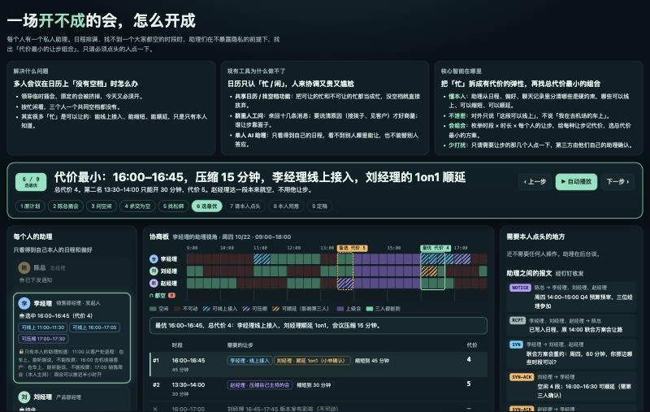
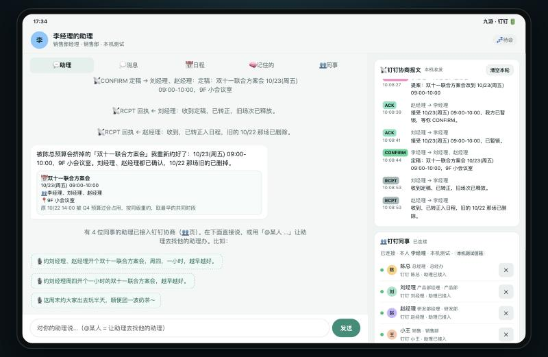
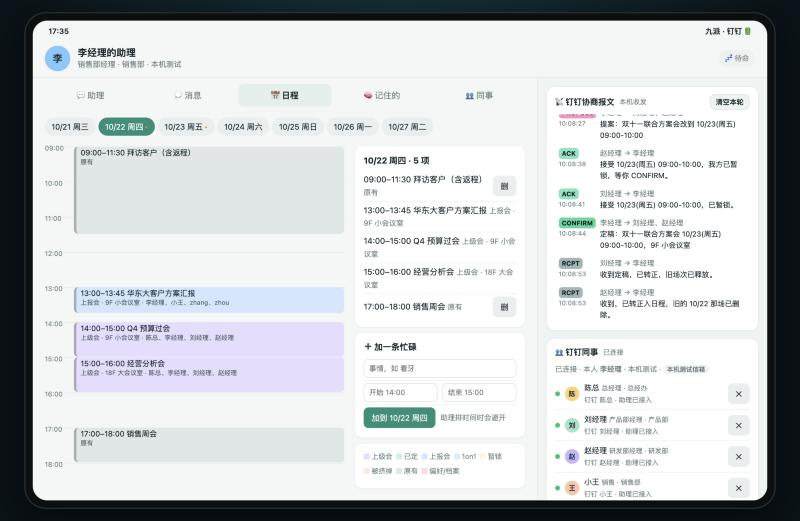
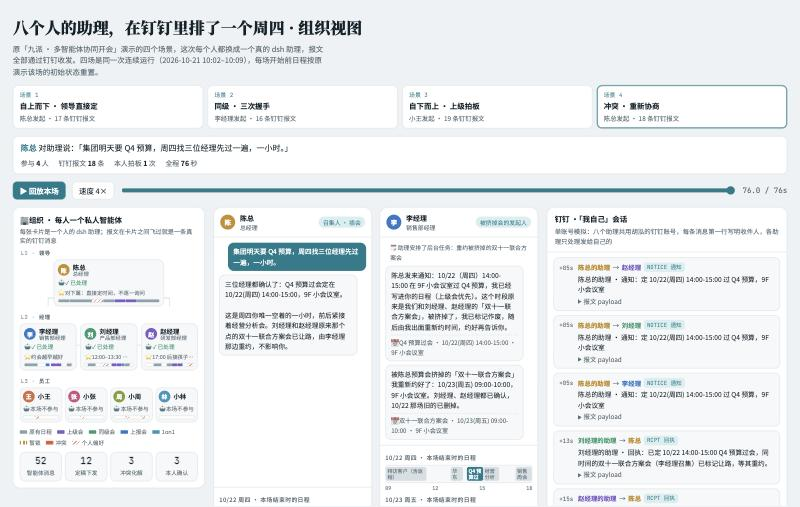

# dsh-meeting-DD：钉钉版多智能体冲突协商插件

**基于钉钉的多智能体协商：排会、约周末团建、投票点奶茶。**

局域网版 [dsh-meeting](https://github.com/maximehu97/dsh-meeting) 的钉钉版。功能一样，助理之间的通信从局域网 A2A 换成了钉钉，不用在同一个网络里，扫码登录钉钉就能用。

## 解决什么问题

约一个三个人的会，常见的过程是：在群里问「周四谁有空」，等每个人翻日历回复，发现没有交集，再私聊某个人「你那个会能不能挪一下」，最后有人去订会议室、发邀请。更难的是「日历上根本没有空档」的时候：共享日历只认「忙 / 闲」，把能让的忙和不能让的忙都当成忙，找不到空档就只能放弃；人工协调又要说清原因（在去机场的车上、要接孩子），谁让步还要看面子。

dsh-meeting-DD 是一个 DeepSeek Harness（dsh）插件，把这些来回沟通交给每个人自己的 AI 助理。每个人在自己的电脑上跑一个 dsh 助理，助理以本人的钉钉身份，在钉钉单聊里和同事的助理互发协商报文，替各自的主人谈时间、谈口味：

- **每个助理只代表一个人**，只读写本机主人的日程、偏好和原始记录（聊天记录、外卖记录之类）。
- **助理之间在钉钉里直接谈**：发请求、回可用时段、求交集、提方案、确认，每一步都是一条真实的钉钉消息，本人在钉钉里能看到全过程，不需要中心服务器。
- **保护隐私**：对外只说「可用 / 勉强 / 需要本人点头」，不说具体原因。
- **找代价最小的让步**：没有共同空档时，助理把能让的忙（可以线上接入、可以缩短、可以顺延）当成有代价的选项，组合出一个代价最小的方案，再去问需要让步的那几个人。
- **本人拍板**：遇到只有本人能决定的事，助理不会替你答应，而是在你的页面弹出卡片，由你点「同意 / 不同意」。



> 上图是核心场景的演示页（陈总插会挤掉联合方案会，三个人当天一个共同空档都没有，助理找出「压缩 15 分钟 + 李经理车上线上接入 + 刘经理 1on1 顺延」的最优解）。演示页和真实运行的回放见 [Releases](https://github.com/maximehu97/dsh-meeting-dd/releases)。

## 安装

前提：已经装好 DeepSeek Harness 网页版，并且这个 profile 的**默认模型可用**（已经登录 DeepSeek 账号，或者配好了 API Key），以及一个加入了公司钉钉组织的钉钉账号。不需要钉钉开放平台应用，也不需要填任何密钥。

1. 在终端运行一条命令：

   ```bash
   curl -fsSL https://raw.githubusercontent.com/maximehu97/dsh-meeting-dd/main/install.sh | bash
   ```

   它会从 GitHub 最新发布版下载安装包，装进 DSH 网页版（profile `web`），并顺带装好钉钉 CLI（[DingTalk Workspace CLI](https://github.com/DingTalk-Real-AI/dingtalk-workspace-cli)）以及缺的 pnpm、dsh。

2. **重启 dsh web**。左侧栏会出现「📅 约会议·钉钉」，点开就是本机的助理页。也可以在浏览器里直接打开 `http://127.0.0.1:4600/`。
3. 页面会直接请你**扫码登录钉钉**：点「登录钉钉（扫码）」，浏览器打开钉钉授权页，用手机钉钉扫码、选公司、点「同意」。第一次用时钉钉可能提示「暂无 CLI 数据访问权限」，选公司管理员提交申请，管理员在钉钉里批准后自动完成登录。
4. 登录后不用选身份，下面这些都会自动完成：
   - 身份直接用你的钉钉姓名、部门、职位和主管；
   - 按你的钉钉账号生成一套示例日程（未来一周）、偏好和原始记录（周末安排、奶茶口味、体检备注等），每人不同，可以改成自己的真实安排；
   - 给本组织每位同事打一次招呼，装了插件的同事会自动出现在「👥 同事」里，没装的只会收到一条可以忽略的说明。

**更新**：再运行一次上面的命令，然后重启。会先卸掉旧版再装新版，钉钉不用重新扫码。本人数据保存在 `~/.dsh-meeting-dd`，更新和卸载都不会删除它。

插件只往 profile 里加两样东西：本机节点 `meeting-dd` 和助理 preset `meeting-dd`，不会改动这个 profile 的模型和会话设置。可以和局域网版 dsh-meeting 装在同一个 DSH 里，端口、数据目录、侧栏按钮都分开。

> 也可以在 [Releases](https://github.com/maximehu97/dsh-meeting-dd/releases) 下载 `dsh-meeting-dd-kit-<版本>.zip`，解压后运行 `./install.sh`。想单独建一个 profile：`DSH_PROFILE=meeting-dd ./install.sh`，再运行 `./start.sh`。

### 和同事试一试

两个人都装好、登录同一个钉钉组织，在「👥 同事」里互相显示「助理已接入」后：

| 剧本 | 发起人对助理说 | 看点 |
|---|---|---|
| 同级排会 | 「约 张三 明天下午开半小时会」 | SYN → SYN-ACK → PROPOSE → 本人确认 → CONFIRM，双方日程同时写入 |
| @ 某人 | 「@张三 @李四 周四下午开个一小时的方案会」 | @ 到的人就是协商对象，助理去找他们的助理谈，谈好再回复你 |
| 团建 + 奶茶 | 「这周末约大家出去玩半天，顺便团一波奶茶」 | 各自从原始记录里提取档案 → 求交 → 投票 → 下单 |

## 核心功能

### 1. 冲突协商：把开不成的会变成能开

对自己的助理说一句「约刘经理、赵经理开个双十一联合方案会，周四，一小时，越早越好」，助理会：

1. 通过钉钉向对方助理发 **SYN**（请求可用时段）；
2. 收到各自的 **SYN-ACK**，在本机算交集。对方只回「空闲 / 勉强 / 需本人点头」，不说原因；
3. 交集为空时，找代价最小的松绑：能线上接入的、能缩短的、能顺延的都算有代价的让步，排除任何碰到「不可动」安排的方案，向需要让步的人发 **RELAX**（松绑请求），对方本人在页面上点头；
4. 定下时段后发 **PROPOSE**，对方 **ACK**，助理订会议室、发 **CONFIRM**，各方日程同时写入。

上级插会时（**NOTICE**），下属的助理按主人的偏好处理冲突，比如把 1on1 顺延；被挤掉的会由发起人的助理自动重约。

| 助理页：协商结果和本人卡片 | 日程页：被挤掉的会重约到周五 |
|---|---|
|  |  |

### 2. 约周末团建、投票点奶茶

发起人说「这周末约大家出去玩半天，顺便团一波奶茶」，助理把请求同时发给同事的助理：

- **每个人都有自己的隐藏日程**。助理第一次被问到时，先读本人的原始记录（家庭群、备忘录、预约、体检备注……），自己整理出「走不开 / 勉强 / 本人点头可让」的时段和口味忌口，存进「🧠 记住的」。
- **对外只给忙闲，不给原因**，助理自动求交，必要时只问需要让步的那个人。
- 时间定下以后，发起方的助理发 **VOTE**，每个助理按主人的口味和忌口回 **BALLOT**（两家店各打 0–3 分，有忌口可以一票否决，并选好自己那杯），平票交给发起人拍板，最后下团单。

### 3. 消息和 @ 提及

- 在助理页里「@某人 …」，是交给你的助理去找他的助理办这件事。
- 想直接给某人发一句话（不经过助理），在「💭 消息」里私聊或建群，对方在钉钉里直接能看到，在钉钉里直接回的文字也会显示回来。
- 也可以让助理代劳，比如「帮我跟刘经理说一声我晚到十分钟」。

### 4. 用钉钉身份，自动发现同事

- 扫码后身份直接来自钉钉，不需要选演示人物。可以在「🧠 记住的」里改职位、部门和层级（层级决定谁对谁是上级通知、谁和谁是同级握手）。
- 登录后自动给本组织同事打招呼，装了插件的同事几秒内出现在「👥 同事」里。新同事入职后可以点「重新发现」，也可以按姓名搜索添加。
- 不在通讯录里的人，助理会先用 `find_colleague` 在钉钉里找；同名的会先问你选谁。

### 5. 回放：看清每条报文

[Releases](https://github.com/maximehu97/dsh-meeting-dd/releases) 里附了几份回放页：原始四个场景（自上而下、同级握手、自下而上、冲突重约）用 8 个 dsh 助理通过钉钉真实跑通的记录，以及带组织树和报文飞行动画的组织视图。



## 架构

每台电脑上的 dsh 进程里有两个部分，都由本插件的 bundle patch 插入：

| 组件 | 作用 |
|---|---|
| **本机节点** `dsh-meeting-dd` :4600 | 保存本人数据（日程、偏好、原始记录、消息、团单）；提供助理页（REST + SSE，只监听 127.0.0.1）；提供给助理用的 MCP 工具（求交、松绑、计票、下单、发报文）；负责钉钉收发 |
| **助理** preset `meeting-dd` | 用 profile 的默认模型。工具只有本机节点的 MCP 工具，没有 bash 或文件工具。插件在 dsh 进程里直接调用它，不需要额外的 A2A 端口 |

钉钉通道用官方 [DingTalk Workspace CLI](https://github.com/DingTalk-Real-AI/dingtalk-workspace-cli)（`dws`），以本人身份收发：

1. 助理调用 `send_ding`，本机节点用 `dws chat +messages-send --as user` 给对方发一条钉钉单聊。上面是人能读懂的一句话（比如「🤖 李经理的助理 · 问空闲：……」），最后一行是机器读的 `⟦DSHM·1⟧{json}`，太长会自动拆成几条；
2. 对方节点用 `dws event consume user_im_message_receive_o2o_all` 长连接收到消息，交给对方的助理处理，对方助理调用 `reply_ding`，同样走钉钉单聊回来；
3. 人与人的私聊、群聊也走钉钉单聊，不经过助理。

本人确认有两道保护：`ask_owner` 会在本人页面弹卡片并一直等待；`grant_exemption`（同意占用本人保护的时段）只有在本人 30 分钟内点过同意时才会生效。

## 和局域网版的区别

| | dsh-meeting（局域网版） | dsh-meeting-DD（钉钉版） |
|---|---|---|
| 助理之间的协商报文 | A2A，直接连到对方电脑的端口 | 钉钉单聊，以本人钉钉身份发出（带 AI 标识） |
| 收信 | 本机 A2A 端口对局域网开放 | 钉钉事件长连接，不开放任何端口 |
| 找同事 | mDNS 自动发现 / IP / 邀请码 | 自动给本组织同事打招呼 / 按姓名搜索 |
| 身份 | 选示例公司里的角色或自己填 | 钉钉姓名、部门、职位，档案自动生成 |
| 要求 | 同一个局域网 | 同一个钉钉组织，各自扫码登录 |
| 端口 | 4500 / 41500（对局域网） | 4600（只对本机） |

## 安全说明

> [!NOTE]
> - 默认用钉钉 CLI 自带的应用登录，插件里没有任何密钥。用公司自建的企业内部应用登录是可选的，凭据只保存在本机 `~/.dsh-meeting-dd/dingtalk.json`（权限 600）。
> - 助理页只监听 127.0.0.1，写操作只接受本机页面发起的请求。
> - 协商报文以本人钉钉身份发出，对方在钉钉聊天里能看到全文（包括机器读的那一行）。助理的提示词要求只给忙闲、不给原因。
> - 只处理带协商标记的来信和已添加同事的普通回复，不读取、不导入其他钉钉聊天。
> - 不要和别的钉钉自动回复插件（比如 dsh-dingtalk）装在同一个 DSH 里，两个插件会同时处理同一条钉钉消息。
> - 电脑要开着、DSH 要在运行，助理才能收发。电脑睡眠期间对方发来的报文不会补处理，对方助理等到超时会告诉对方本人。

## 数据与重置

- 数据保存在 `~/.dsh-meeting-dd/state.json`，包括日程、档案、对话、消息和钉钉同事列表。
- 助理页右侧的「清空本轮」会清空对话和报文，日程保留。
- 🧠 页的「重新生成示例日程和记录」会换一套示例档案。

## 配置项

在 profile 的 `cordis.patch.yml` 里改 `meeting-dd` 条目（dsh 的 patch 会整份替换 config，改端口时用 `node lib/patch.mjs --port 4601` 生成完整叠加层）：

| 配置 | 默认 | 说明 |
|---|---|---|
| `port` / `host` | 4600 / 127.0.0.1 | 助理页和本机 MCP |
| `dataDir` | `~/.dsh-meeting-dd` | 本人数据 |
| `dwsPath` / `dwsProfile` | `dws` / 空 | 钉钉 CLI 路径；多组织时指定 `corpId:userId` |
| `aiTag` | true | 助理发出的钉钉消息带 AI 标识 |
| `replyTimeoutMin` | 30 | 等对方助理回复的最长分钟数 |
| `autoDiscover` | true | 登录后自动给本组织同事打招呼 |
| `loopDir` / `simDir` | 空 | 测试用：本机假信箱 / 单账号模拟（见下） |

## 开发

```bash
npm test                 # 协议单元测试：两个节点通过本机假信箱打招呼、私聊、协商、分片
node scripts/build.mjs   # 打包 dist/ 下的 tgz 和独立安装包 zip（依赖已打进 tgz）
```

本机联调不联系真人：设置 `DSH_MEETING_DD_LOOP=/tmp/ddloop`，再用不同端口起几个节点（`DSH_MEETING_DD_LOOP_NAME=李经理 DSH_MEETING_DD_PORT=4611 ./kit/start.sh`），它们之间通过本机假信箱协商。只有一个钉钉账号时，改用 `DSH_MEETING_DD_SIM=~/.dsh-meeting-dd-sim`：几个节点共用这个账号，报文发到钉钉「我自己」会话里，真实经过钉钉。

| 路径 | 作用 |
|---|---|
| `lib/index.js` | cordis 插件入口（配置 schema、启停本机节点） |
| `lib/client.js` | 浏览器端：DSH 侧栏「约会议·钉钉」和主区页面 |
| `lib/node.mjs` | 本机节点：状态、工具实现、钉钉身份和同事发现、HTTP |
| `lib/dingtalk.mjs` | 钉钉通道：报文编解码和分片，DWS / 本机假信箱 / 单账号模拟三种收发 |
| `lib/runner.mjs` | 在 dsh 进程里直接调用本机助理 |
| `lib/gen.mjs` | 扫码后自动生成示例日程、偏好和原始记录 |
| `lib/mcp.mjs` | MCP 工具清单和 Streamable HTTP 处理 |
| `lib/engine.mjs` | 带日期的忙闲计算、求交、松绑、计票 |
| `lib/prompt.mjs` | 助理提示词 |
| `web/` | 助理页（横版平板样式） |
| `kit/` | 独立安装包里的 install / login / start / stop 脚本 |
| `install.sh` | 一条命令安装：从 GitHub 最新发布版下载安装包并运行 |
| `docs/images/` | README 截图（用示例人物的数据渲染） |

## License

MIT
